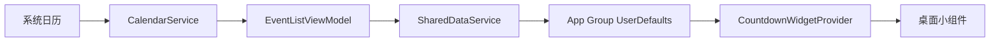

# 待到 / Until 产品文档

## 1. 产品概述

待到（Until）是一款面向 iOS、HarmonyOS 与 Android 用户的轻量级纪念日管理工具。产品支持用户记录生日、纪念日等重要日期，自动计算距离下一次发生日期的剩余天数，并通过各平台桌面组件快速展示即将到来的重要日子。

产品当前已在 iOS 与 HarmonyOS 上线，Android 原生版本已进入设备验收阶段。各端分别使用平台本地存储，不提供跨设备数据同步；产品规则、功能范围与视觉语言通过跨平台契约保持一致。

## 2. 产品定位

- 产品类型：个人效率与生活提醒工具
- 使用平台：iOS App 与 Widget、HarmonyOS App 与服务卡片、Android App 与 Glance Widget
- 核心价值：集中管理生日、纪念日和自定义重要日期，并以倒计时方式降低遗忘成本
- 体验关键词：轻量、直观、自动同步、桌面可见
- 平台策略：iOS、HarmonyOS 与 Android 保持核心功能、规则和视觉语言同步，使用各平台原生能力实现

## 3. 目标用户

- 经常需要记住家人、朋友生日的用户
- 需要关注结婚纪念日、恋爱纪念日、入职纪念日等周期性日期的用户
- 希望把重要日子固定显示在桌面小组件中的用户
- 希望通过桌面组件或服务卡片快速查看最近重要日期的用户
- 不希望重复维护系统日历与倒计时 App 两份数据的用户

## 4. 用户痛点

- 系统日历可以记录事件，但不够突出“还剩几天”的倒计时信息
- 生日、纪念日分散在不同日历中，用户需要主动翻找
- 手动添加纪念日后，用户希望它可以每年自动重复
- 打开 App 查看提醒存在成本，桌面直接可见更符合高频提醒场景

## 5. 产品目标

- 自动识别系统日历中的生日与纪念日事件
- 将重要日期按剩余天数从近到远排序
- 支持手动创建生日、纪念日和自定义事件
- 支持将手动创建的事件同步为系统日历中的每年重复日程
- 支持为事件设置本地通知提醒
- 通过小组件展示最近的 1 至 3 个重要日期
- 在权限不足时提供清晰的引导与降级能力
- 支持简体中文与英文界面，并默认跟随系统语言和区域格式

## 6. 功能范围

### 6.1 日历授权

各平台在需要读取、创建或修改系统日历时请求相应权限；拒绝权限不影响本地倒计时功能。Android 版在用户授权后读取未来两年的日历实例，识别标题含生日或纪念日关键词的事件；开启“同步到本机日历”后，可创建、更新和删除由待到同步的年度事件。

Android 2.0.5 导入时读取源事件的 RRULE 和原始开始日期，识别能够完整表达的每年、每月、每周规则，不把导入实例的下次时间作为重复起点。带间隔、多星期、次数/截止限制、额外或排除日期、单次例外的规则，以及没有重复规则的单次日程，暂不导入并显示跳过数量；原系统日历不修改。刷新时按系统事件标识合并，校正旧导入记录的重复方式并保留内部 ID、提醒与未出现的旧记录；明确发现规则不支持的旧导入记录从当前列表移除并取消应用提醒，其他记录不受影响。读取失败或返回空游标时保留原数据并提示失败。保存前重新检查源事件：只改标题/备注时不修改其 RRULE、开始/结束时间、全天属性或时区；源规则不支持、无法读取或不存在时阻止本次保存，留在编辑页提示处理，避免静默降级成每年或重建另一条日历事件。

### 6.2 年度日期规则

App 根据用户选择的日期计算下一次年度发生日期。年度日期按月日计算；如果日期为 2 月 29 日，非闰年会继续寻找下一个有效闰年日期。用户手动选择的未来日期作为这条事件的第一次发生日期保留，第一次发生后再按月日进入年度重复；因此选择明年的今天不会被提前显示为今天。

Android 2.0.4 增加“每年 / 每月 / 每周”，作为当前平台增量；iOS 和 HarmonyOS 维持现有年度规则。每月按所选公历或农历的同一日重复，遇到没有该日的月份直接跳过，不提前到月底；例如公历 31 日跳过 2 月，农历三十跳过小月，农历闰月作为独立月份参与重复。每周从所选实际日期起每 7 天重复，即固定同一星期，公历和农历采用相同的周规则。未来原始日期在三种模式下都作为首次发生日期保留。旧记录缺少重复字段时按年读取，升级不会改变原有生日、纪念日或清空事件。

Android 首页、详情、排序和桌面组件都使用同一重复规则计算下次日期；月/周农历事件展示下一次实际发生的农历月日。详情明确显示重复方式。编辑重复规则后，取消旧提醒并按新规则重新排程；提醒触发后继续安排下一个有效周期，提前 7 天的周提醒不产生过去时间的闹钟。公历日历同步分别写入 YEARLY、MONTHLY、WEEKLY 规则；农历仍仅保存在本地。

### 6.3 事件列表

事件列表展示所有倒计时事件，并按剩余天数升序排列，最近到来的事件排在最前。

列表项信息：

- 事件类型图标
- 事件名称
- 下一次发生日期，格式为 `M月d日`
- 事件来源小图标，用于区分本地事件和 App 同步日历事件；旧版本导入记录作为本地副本兼容展示
- 剩余天数
- 紧急程度颜色，整体采用低饱和、温和提醒的视觉策略，避免强警告感

紧急程度规则：

- 今天：柔和玫瑰色，表示需要关注
- 1 至 7 天内：柔和琥珀色，表示近期临近
- 8 至 30 天内：低饱和青绿色，表示即将到来
- 30 天以上：低饱和绿色，表示常规未来事件

紧凑列表和小组件中的剩余天数超过 999 天时，中文显示“遥遥有期”，英文显示 `1000+ days`，避免数字挤压布局；详情和无障碍文案仍使用准确日期与准确剩余天数。

列表支持按事件类型筛选：

- 全部
- 生日
- 纪念日
- 自定义

### 6.4 搜索

用户可以在事件列表中按事件名称搜索。搜索仅影响当前列表展示，不改变数据源。

### 6.5 下拉刷新

用户可以通过下拉刷新重新加载本地倒计时数据并更新列表展示。支持系统日历导入的平台会在授权后合并符合规则的生日与纪念日事件。

### 6.6 手动添加事件

用户可以手动新增倒计时事件。

Android 新增与编辑日期弹窗区分公历与农历：公历使用月历，农历使用独立的年、月、日选择列，按年份提供闰月，并显示农历名称及对应公历。农历支持 1900–2100 年；切换年份时不存在的闰月回到同名普通月，切换至小月时将三十调整为廿九。公农历切换保留同一实际日期，点击“完成”才写回表单，取消不改变日期、历法或日历同步开关。农历表单摘要显示农历年月日及对应公历，避免两种历法看起来相同；选择不依赖三星等厂商日历控件的农历支持。范围外日期明确提示并禁止确认，不将公历数字伪装为农历。

表单字段：

- 名称：必填
- 类型：生日、纪念日、自定义
- 日期：必填，使用图形化日期选择器
- 重复：Android 可选择每年、每月、每周，默认每年；其他平台保持现有年度行为
- 备注：选填
- 本地提醒：不提醒、当天、提前 1 天、提前 3 天、提前 7 天
- 是否同步到系统日历：默认开启

HarmonyOS `2.1.1` 首用激活实验采用平台差异：新增事件的系统日历同步默认关闭，提醒默认选择“提前 1 天”并放在第一个选项，用户可在保存前改为其他提前量或“不提醒”；保留提醒的事件保存后再请求通知权限。其他平台维持当前默认值，待版本级留存结果验证后再决定是否统一。

保存逻辑：

- 本地数据写入成功即决定保存结果；后续系统日历同步、通知授权或提醒排程失败不回滚事件；HarmonyOS 首次保存可展示一次服务卡片承接，其余情况返回首页
- 如果开启同步且拥有普通日历写入权限，则在后台创建每年重复的全天事件
- 后台日历同步失败时保留本地倒计时，并通过即时提示说明同步失败
- 如果关闭同步，或没有日历写入权限，则仅保存为本地倒计时事件
- HarmonyOS 首次保存本地事件后展示一次非强制成功承接，只引导添加服务卡片；提醒在新增表单中完成配置，跳过卡片引导不影响事件，也不会在当前会话重复弹出

### 6.7 删除事件

用户可以在列表中通过长按操作删除事件，详情页也提供删除入口。所有删除操作执行前都必须展示确认提示。

删除逻辑：

- 如果事件为旧版本导入的系统日历记录，仅删除待到中的本地副本，不修改系统日历原始日程
- iOS 可额外将导入事件隐藏并在后续恢复；该能力仅限 iOS，不属于 HarmonyOS 与 Android 的统一功能范围
- 如果事件为 App 自己创建并同步到系统日历的事件，删除时先删除对应系统日历事件；失败时保留 App 内记录
- 如果事件为本地事件，则仅从本地共享数据中移除
- 删除后刷新小组件时间线
- 删除事件后取消该事件已排程的本地通知

### 6.8 Widget 与服务卡片

iOS Widget 支持小、中、大桌面尺寸及锁屏尺寸；鸿蒙使用服务卡片；Android 使用 Glance Widget，小尺寸突出 1 个事件，其他尺寸按可用空间展示主事件及后续列表。主题、指定事件和锁屏能力按平台原生能力提供。

Android 2.0.6 改用组件实际可用宽高计算展示容量，取消固定最多两三条后续事件以及固定最大拉伸尺寸的限制；拖动边框时重新计算。Android 2.0.7 在切换纵向或宽松布局前检查展示容量，放大组件不得减少后续条目；空间不足时保留原布局。主事件、标题、字号、行高、间距与底部安全留白先占预算，仅展示能够完整放下的后续条目，事件不足时不补占位。窄高组件使用紧凑纵向布局；组件字号适度限制，放大字体时增加行高并减少条数。主事件的倒计时数字与“天”同排、保留字形余量，避免固定高度挤掉单位；横向组件左侧主卡保持独立宽度，不占满右侧列表空间。

Android 所有应用内路由在统一导航容器避让状态栏、系统导航区和屏幕切口，向下消费已处理的安全边距，避免首页、新增/编辑、详情与组件设置标题被系统栏遮挡或重复留白；仍保留背景延伸至系统栏的显示方式。

HarmonyOS 在有事件后长期展示“桌面卡片”入口，不与提醒激活状态绑定。卡片中心通过系统运行卡片列表校准桌面上的真实实例和 Form ID；未添加卡片时只说明价值并进入系统添加页，不展示模拟预览或提前保存配置。添加成功后，用户可逐张选择自动显示最近日子或固定显示某个日子，并分别选择智能、靛蓝或深色配色。固定模式会让选中事件始终占据小卡片唯一位置或中、大卡片首位，其余事件仍按日期排序。所有事件与卡片配置只保存在本机；旧卡片缺失配置时迁移为自动内容和智能配色。

小组件信息：

- 事件名称
- 事件类型图标
- 月日
- 剩余天数
- 紧急程度颜色

Widget 与服务卡片在事件保存成功后使用最新内存数据立即主动刷新；HarmonyOS 卡片入口必须绑定 Form `LocalStorage`，且卡片根节点观察每次都变化的更新令牌并替换渲染子树，确保 `updateForm` 下发的新事件会重建可见内容。保存后进行两次短延迟确认刷新，应用退到后台时再校准一次，并在跨日后更新时间线，以保持事件内容与倒计时天数准确。

### 6.9 本地通知提醒

用户可以为事件开启本地通知提醒。

提醒选项：

- 不提醒
- 当天 09:00
- 提前 1 天 09:00
- 提前 3 天 09:00
- 提前 7 天 09:00

通知逻辑：

- 只有事件保存时提醒不是“不提醒”才请求通知权限
- 提醒使用平台本地通知，不依赖服务器
- 事件新增、编辑或删除后，App 会重新排程待发通知
- 如果用户拒绝通知权限，倒计时展示、日历导入和本地保存仍可正常使用

### 6.10 本地化

App 与 Widget 支持简体中文和英文。界面文案、事件类型、倒计时状态、错误提示、Widget 名称与描述、日历权限说明均应随系统语言自动切换。

日期展示与日期选择器应使用系统默认区域格式，不固定为单一语言或地区格式。英文环境下倒计时天数应符合英文单复数规则。

### 6.11 低频彩蛋

首批彩蛋包含特别数字暗语和“深夜来信”，仅在主 App 中展示，不进入 Widget 或服务卡片：

- 事件详情剩余 42 天时显示“答案正在路上”，剩余 365 天时显示“绕太阳一圈后见”；英文环境显示分别创作的等义文案
- 剩余 520 天时仅在中文环境显示“心动有期”，英文环境不展示该数字彩蛋
- 特别数字暗语只作为详情页辅助文案，不替换准确倒计时
- “深夜来信”仅在本地时间 00:00 至 05:00、当前列表非空且距离上次展示至少 30 天时，按低频日期规则显示在列表末尾
- “深夜来信”不发送通知、不触发后台任务，也不记录或上传用户作息
- 彩蛋不改变事件数据、排序、提醒、系统日历状态或组件内容
- 剩余天数超过 999 天时，详情页顶部倒计时保持紧凑文案；长按 1.5 秒后进入全屏低饱和星空，星点从屏幕四周缓慢向中心汇聚，再以大字号显示精确天数和“所有遥遥有期，都在一天天靠近。”的等义本地化文案
- “遥遥有期”揭示仅在详情页触发，避免与列表长按管理菜单冲突；约 4.6 秒后自动结束，也可点击全屏效果提前关闭
- 事件到达当天时，每个事件每天首次进入详情页自动播放一次“等到了”庆祝；生日使用系统原生或代码绘制的气球，不使用字体相关的气球 Emoji，纪念日使用爱心，自定义事件使用星星
- 当天事件可通过长按详情顶部倒计时手动重播一次庆祝；庆祝不播放声音、不阻塞操作
- iOS 开启“减少动态效果”时移除粒子位移；HarmonyOS 使用短暂显隐和静态符号；Android 使用 Compose 本地动画且不播放声音

## 7. 核心用户流程

### 7.1 首次使用流程

以下流程为支持首启日历导入的平台通用流程。HarmonyOS `2.1.1` 不在首启主动请求日历权限，改用 7.4 的本地激活流程。

1. 用户打开 App
2. App 请求日历完整访问权限
3. 用户授权
4. App 读取系统日历中的生日与纪念日
5. App 按剩余天数展示倒计时列表
6. App 将数据保存到 App Group，供小组件读取

### 7.2 手动新增并同步日历流程

1. 用户点击右上角新增按钮
2. 输入名称，选择类型与日期
3. 保持“同步到日历 App”开启
4. 点击保存
5. App 创建每年重复的系统日历事件
6. 新事件进入倒计时列表
7. 小组件刷新展示最新数据

### 7.3 无日历权限流程

1. 用户拒绝日历权限
2. App 进入主界面，并显示权限提示横幅
3. 用户仍可新增、查看和删除本地倒计时
4. 用户可点击“打开设置”
5. 用户在系统设置中重新开启权限
6. 回到 App 后重新加载日历数据

### 7.4 HarmonyOS 首用激活流程

1. 用户打开 App，空首页展示生日、纪念日和自定义三个快捷新增入口
2. App 不在首启请求日历或通知权限
3. 用户选择类型并创建第一个本地倒计时事件
4. 本地保存成功后展示一次成功承接
5. 用户可选择添加服务卡片或暂时跳过；提醒已在新增表单中完成配置
6. 完成任一提醒或服务卡片后视为基础激活，首页不再展示任务卡
7. 跳过后回到正常首页，任务卡按本地冷却规则低频出现

## 8. 数据模型

倒计时事件包含以下字段：

| 字段 | 类型 | 说明 |
| --- | --- | --- |
| `id` | UUID | App 内部唯一标识 |
| `title` | String | 事件名称 |
| `nextOccurrence` | Date | 下一次发生日期 |
| `originalDate` | Date | 原始日期，用于每年重新计算 |
| `category` | EventCategory | 事件类型 |
| `dateCalendar` | EventDateCalendar | 日期使用的历法，支持公历和农历 |
| `source` | EventSource | 事件来源：本地、App 创建的日历事件、导入的系统日历事件 |
| `calendarEventID` | String? | 对应系统日历事件 ID |
| `calendarItemID` | String? | 对应系统日历项目 ID，用于刷新后匹配导入事件 |
| `notes` | String? | 备注 |
| `reminderLeadTime` | ReminderLeadTime | 本地通知提前量，支持不提醒、当天、提前 1/3/7 天 |

事件类型：

- `birthday`：生日
- `anniversary`：纪念日
- `custom`：自定义

## 9. 数据存储与同步

主 App 与 Widget 通过 App Group 共享数据。

当前共享配置：

- App Group ID：`group.com.khalil.until`
- 存储方式：App Group UserDefaults
- 存储格式：JSON 编码后的 `[CountdownEvent]`
- 存储 Key：`countdownEvents`

数据同步链路：

## 10. 权限与隐私

产品需要访问用户日历，用于读取生日、纪念日并创建用户主动添加的重复事件。若用户为事件开启本地提醒，App 会请求通知权限用于发送本地通知。

权限说明：

- 主 App 使用 EventKit 请求完整日历访问权限
- 本地通知权限仅在用户开启事件提醒时请求
- Widget 不直接访问系统日历，仅读取主 App 写入的 App Group 数据
- 用户手动添加的备注会随倒计时事件一起保存在 App Group UserDefaults 中

隐私原则：

- 不上传用户日历数据
- 不上传通知提醒数据
- 不使用第三方服务同步数据
- 小组件仅读取必要的倒计时事件信息

## 11. 界面结构

主 App：

- 权限提示横幅：在日历权限受限时展示，同时保留主界面本地使用能力
- 事件列表页：展示、搜索、刷新、删除倒计时事件
- 事件详情页：保留类型、原始日期、下一次发生、重复、提醒、历法和来源，拆分为“基本信息”和“提醒与来源”两组；导航、卡片圆角、字号层级和区块间距与新增/编辑页保持一致；事件类型使用彩色立体 Emoji，日期、提醒等功能图标使用线性 SVG 圆底；年份合并进原始日期，农历的原始日期与下一次发生均按“农历日期／对应公历日期”分两行显示；有备注时才展示备注；顶部提供编辑、底部保留删除
- 新增/编辑事件页：创建或更新生日、纪念日或自定义日期；表单按名称与类型、日期、提醒和更多设置分组，生日、纪念日和自定义分别使用 🎂、💝、✨，名称左侧图标与当前类型联动，类型选择、首页列表、详情和服务卡片使用同一图标映射；日期和提醒采用主卡片展示，底部保存按钮保持页面安全边距
- 本地通知提醒：在新增/编辑事件时配置提醒提前量
- HarmonyOS 首用激活：空数据时隐藏右上角普通新增按钮并使用快捷新增首页；提醒在新增表单中配置，首个事件保存后只承接服务卡片；已有事件但尚未激活时使用可关闭的非模态任务卡
- HarmonyOS 卡片中心：有事件后保持首页常驻入口；无卡片时只进入系统添加页，有真实卡片后才显示逐卡内容模式、固定日子、配色和继续添加入口
- HarmonyOS 农历详情：下一次发生日期使用两行自适应布局，完整展示年份、农历月日和对应公历月日

Widget 与服务卡片：

- 小尺寸组件：突出最近一项倒计时
- 中尺寸组件：展示主事件与最多三项后续事件，共四项；主事件采用顶部类型标识、名称与底部倒计时的三段式层级，事件名不落在组件底边，倒计时拥有清晰而稳定的视觉落点
- 大尺寸组件：展示主事件与最多五项后续事件，共六项；采用“克制顶栏 + 倒计时舞台 + 连续时间线”的视觉结构，顶栏仅保留品牌、当前分组和数量；主事件顶部呈现类型与日期，底部将名称置左、醒目但克制的倒计时置右，形成均衡的双栏焦点，确保只有一个视觉中心；后续事件合并在同一块时间线面板中，避免多张胶囊卡造成视觉碎片。布局密度随事件数量自适应：优先收缩次级行高与主事件标题行数，但不得将可读字号压缩到与可用空间不匹配；主事件高度不随剩余空间无限放大；时间线面板承接多余空间时，事件行在面板内均匀分布，不能把空余高度集中在最后一项之后，并始终保留舒展的阅读节奏和清晰的点击目标；平台支持时提供
- 组件配置：支持自动最近事件、指定事件和主题选择，具体能力按平台实现

Apple Watch 后续方向：

- Watch App：展示最近的 1 至 5 个倒计时事件
- Complication：在表盘上展示最近一个重要日期或今日事件
- 通知：承接 iPhone 端提醒策略，以轻量、可忽略为原则
- 管理能力：优先查看，不承载复杂新增和编辑流程

### 11.1 视觉设计原则

- 提醒感应明确，但不制造压迫感
- 避免高饱和大面积色块，颜色主要用于图标、数字和轻量徽章
- 重要日期使用温和强调，默认状态保持安静、清爽
- 事件类型采用彩色立体 Emoji 提升辨识度；功能性操作继续使用简洁线性图标，避免视觉层级混乱
- 优先使用系统控件、系统材质和语义化层级，降低后续适配成本
- iOS 26 方向上，导航、搜索、筛选和浮动操作区优先跟随系统 Liquid Glass；事件内容本身保持清晰，不做过度玻璃化

## 12. 异常与边界场景

- 无日历权限：主界面仍可使用本地倒计时，并展示权限提示横幅和设置入口
- 日历读取为空：展示空状态，引导用户添加事件
- 小组件无数据：展示暂无日程文案
- 创建系统日历事件失败：展示错误提示
- HarmonyOS 首次保存引导被跳过：事件保持成功状态，当前会话不重复弹出，首页任务卡遵守本地冷却时间
- HarmonyOS 无法打开系统卡片管理页：保留事件并展示手工添加步骤，不将其视为保存失败
- 用户拒绝通知权限：不影响事件保存和倒计时展示，仅不发送本地提醒
- 重复日历事件：按标题、月份、日期去重
- 已过年度日期：自动计算为下一年的同月同日
- 2 月 29 日：非闰年继续寻找下一个有效闰年日期
- 系统语言切换：App、Widget 与权限说明应跟随系统语言展示对应文案
- 特别数字未命中或语言不适用：不保留空白占位
- 深夜来信处于冷却期、白天时段或列表为空：不展示，也不影响正常列表布局
- 设备时间被调早导致上次展示时间位于未来：继续视为冷却期，不重复展示
- 同一天有多个到达事件：按事件分别记录自动庆祝状态，首次进入各自详情时均可触发
- 到达日详情被重复打开：当天不再自动庆祝，但每次详情展示仍最多允许一次手动重播
- 远期倒计时揭示期间离开详情：停止后续表现，不影响再次进入后的紧凑显示

## 13. 非功能需求

- 响应速度：进入列表后应尽快展示已有数据，刷新过程显示加载状态
- 稳定性：日历读取失败或共享存储失败时不应导致 App 崩溃
- 本地化：支持简体中文与英文，默认跟随系统语言；日期、日期选择器与倒计时复数规则应符合当前系统区域
- 可维护性：主 App、共享模型、Widget 逻辑按模块拆分
- 兼容性：当前实现依赖 iOS 17 相关日历权限与 Widget 背景 API
- 文档维护：新增、调整或移除产品功能时，应同步更新本文档的功能范围、用户流程、边界场景和验收标准
- 彩蛋性能：彩蛋判断仅使用本地日期和现有事件数据，不新增网络请求、后台任务或明显的首屏延迟
- 激活引导状态：HarmonyOS 首用旅程状态仅保存在本机 Preferences，不包含事件标题、日期、备注或系统日历标识，不上传服务器

## 14. 验收标准

- 首次打开 App 能正确请求日历权限
- HarmonyOS 全新安装首次打开不主动请求日历或通知权限，无事件时隐藏搜索与分类并展示三个快捷新增入口
- HarmonyOS 快捷新增入口正确预选生日、纪念日或自定义分类
- HarmonyOS 首个事件本地保存成功后仅展示一次非强制承接，只提供添加服务卡片或跳过，不重复引导提醒
- HarmonyOS 已有事件且没有提醒或服务卡片时展示可关闭任务卡；完成任一回访渠道后任务卡消失
- HarmonyOS 从 `2.0.2` 升级时不自动弹出首次保存承接，原有事件和服务卡片数据保持不变
- HarmonyOS 卡片中心不使用模拟预览；系统查询成功时，已添加数量、尺寸和 Form ID 与桌面真实服务卡片一致
- HarmonyOS 未添加卡片前不保存内容或配色草稿；添加后可按 Form ID 独立配置，删除桌面卡片后本地实例会在下次查询时移除
- HarmonyOS 固定日子模式在小卡片显示指定事件，在中、大卡片将指定事件置顶，其余事件仍按日期排序
- HarmonyOS 已添加服务卡片在新增、编辑或删除日子后会同步最新事件；中卡片最多显示 4 项，大卡片最多显示 6 项；大卡片事件不足时列表连续排列，不出现首尾分散的异常空白；长标题与农历长日期不重叠、不截断
- 授权后能读取系统日历中的生日与纪念日事件
- 事件列表按剩余天数从近到远排序
- 新增事件时，名称为空不能保存
- 必填项缺失或日期无效时，通过即时提示告知用户，不在底部操作区增加持续占位的错误框
- 开启同步后，保存事件会创建每年重复的系统日历日程
- 关闭同步或权限不足时，事件可作为本地数据保存
- 开启本地提醒后，App 能请求通知权限并为事件排程本地通知
- 删除或关闭提醒后，不再保留该事件的待发本地通知
- 拒绝日历权限后，用户仍可进入主界面并新增本地倒计时
- 导入的系统日历事件删除前展示来源说明和确认提示，确认后同步删除系统日历事件
- 系统日历删除失败时保留 App 内记录并提示用户
- 同名但日期或分类不同的本地事件刷新后不会被误去重
- 2 月 29 日事件在非闰年不会回退到已过期原始日期
- 搜索能够按事件名称过滤列表
- 长按列表项或在支持鼠标的设备上右键可发起删除
- 下拉刷新能导入未来近期的普通系统日程，并将其归类为自定义事件
- 用户选择的未来日期在首次到达前不按月日提前折算到本年度
- 超过 999 天的倒计时在紧凑区域中文显示“遥遥有期”、英文显示 `1000+ days`，详情仍展示准确日期
- 小尺寸 Widget 展示最近 1 个事件
- 中尺寸 Widget 展示最多 3 个事件
- 小组件在次日刷新后倒计时天数正确更新
- 系统语言为简体中文时，主 App、Widget 和权限说明展示中文文案
- 系统语言为英文时，主 App、Widget 和权限说明展示英文文案
- 日期展示和日期选择器跟随系统区域格式，英文倒计时文案正确处理 `day` / `days`
- 剩余 42 天和 365 天时，详情页显示对应暗语且仍保留准确倒计时
- 剩余 520 天时，中文环境显示“心动有期”，英文环境不显示该彩蛋
- 深夜来信只在本地 00:00 至 05:00、非空列表、至少 30 天冷却和低频日期条件同时满足时显示
- 两项彩蛋均不改变事件排序、提醒、日历同步和组件展示
- 剩余天数超过 999 天时，详情页长按 1.5 秒显示全屏星点汇聚效果，精确天数在屏幕中心以大字号出现，紧凑徽章不承载四位数，并在约 4.6 秒后恢复
- 每个当天事件每天首次打开详情时只自动庆祝一次，且同日不同事件互不影响
- 当天详情支持一次手动长按重播；生日、纪念日、自定义事件分别使用气球、爱心、星星表现
- 开启减少动态效果后，庆祝和揭示不使用大幅粒子位移；所有表现均无声音且不阻塞详情操作

## 15. 后续迭代建议

近期优先级：

- 优化日历权限被拒绝时的本地添加入口，允许用户在无日历权限时继续使用本地倒计时
- 优化本地通知体验，例如支持自定义提醒时间点和通知权限状态提示

中期优化：

- 支持更多事件分类，如节日、考试、旅行、账单
- 支持置顶；仅 iOS 继续完善已隐藏事件管理
- 支持小组件样式主题配置，包括仅生日、仅纪念日、指定事件等
- 支持 Apple Watch App，提供最近倒计时列表和今日重点事件
- 支持 Apple Watch Complication，在表盘展示最近重要日期
- 支持 iCloud 同步或备份导出
- 增加来源筛选，区分系统日历、本地添加和 App 同步来源

未排期彩蛋：

- “时间账本”：连续点击首页标题后展示本地事件数量、最近事件和可靠的到达统计；不新增联网或上传行为，不展示无法准确计算的历史数据。
- “时间星球”：在支持可靠摇动检测的平台，将列表短暂展示为时间星球动画，再按真实顺序复位；不改变排序和数据，在减少动态效果或页面滚动时不触发。
- 所有彩蛋保持低频、克制、可跳过，并尊重系统“减少动态效果”设置；正式排期前先更新产品契约和功能矩阵。

iOS 26 与视觉优化：

- 在 iOS 26 SDK 下评估 Liquid Glass 自定义 API，用于筛选器、底部新增按钮和轻量浮层
- 保持事件列表内容层级清晰，不对每个列表项大面积使用玻璃效果
- 小组件优先使用系统 Widget 背景与系统材质，不强行自绘重玻璃效果
- 更新 App 图标，适配 iOS 26 图标材质、深浅色和透明效果
- 继续保持低饱和颜色策略，避免把提醒做成强制警告
